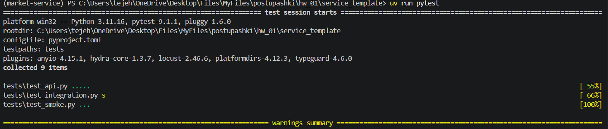
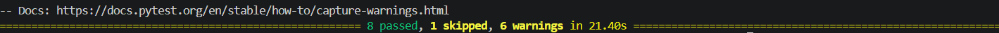
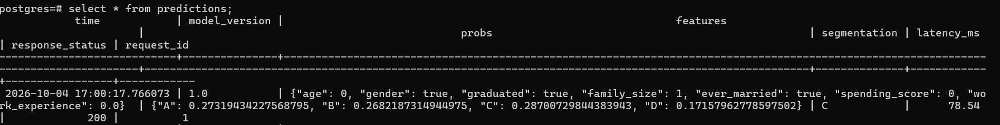
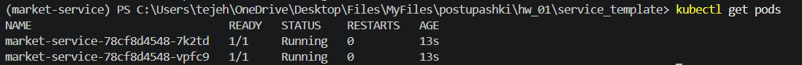
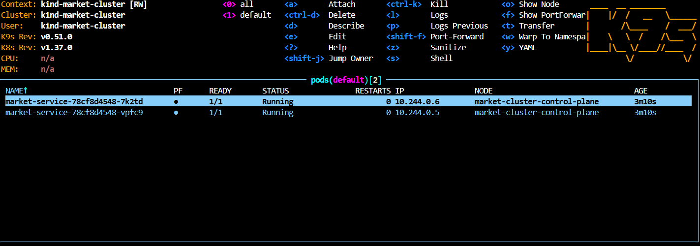
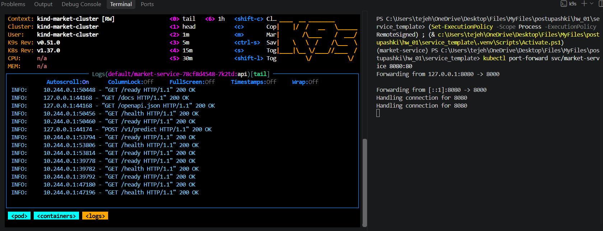

# service_template
# Справочник

1) Helm - пакетный менеджер для Kubernetes
    * helm repo add traefik https://traefik.github.io/charts - добавление в helm репо Traefik
    * helm repo add prometheus-community https://prometheus-community.github.io/helm-charts - добавление в helm репо prometheus
    * helm upgrade -  в Kubernetes используется для обновления уже установленного релиза до новой версии чарта (chart) или изменения его конфигурации. Чарт - это пакет, содержащий все необходимые ресурсы для работы приложения в кластере.

2) Kind (Kubernetes IN Docker) - инструмент с открытым исходным кодом. Позволяет развернуть локальный кластер Kubernetes.
    * kind get clusters - просмотр кластеров
    * kind create cluster --name [cluster name] --config [path to config file] - создание кластера
    * kind load docker-image [docker image] --name [cluster name] - копирует локальный Docker-образ  в узлы работающего кластера Kubernetes

3) Docker - это программная платформа с открытым исходным кодом для контейнеризации.
    * docker pull [image name] - скачивает образ Docker из удалённого реестра в локальную систему.
    * docker port market-cluster-control-plane -  получение информации о том, какой порт внутри работающего контейнера будет доступен извне для взаимодействия с control plane этого контейнера.

4) kubectl - это инструмент командной строки (CLI), который позволяет управлять кластерами Kubernetes.
    * kubectl apply -f [path to yaml file] - создаёт новые ресурсы или обновляет существующие, приводя кластер в состояние, заданное в файле. 
    * kubectl get [options] <resource_type>- для получения информации о ресурсах кластера.

5) k9s - это терминальный интерфейс для удобной работы с кластерами Kubernetes прямо из терминала.
    * k9s -n [namespace] - открыть интерфейс

# Команды для локального запуска:

0) uv sync

1) uv run pytest

2) docker compose -f compose.yaml up -d

3) * kind create cluster --name market-cluster 
* kind load docker-image market-service:v1 --name market-cluster
* kubectl apply -f k8s/
* Запуск в отдельном терминале тунель: kubectl port-forward svc/market-service 8080:80
* kubectl get pods 

# Работа с git

0) git checkout -b test-branch - Создание новой ветки для тестов

1) git push -u origin test-branch - -u флаг устанавливает восходящую связь. В следующий раз достаточно будет выполнить git push, не указывая ветку.

# Скрины:

# 2.

### 1. Кэш build job

В первом прогоне job `build` шёл `16s` секунд, во втором — `18s` секунд
(ссылка на первый прогон: https://github.com/Radfull/service_template/actions/runs/38894380401/job/116951410234, 
на второй: https://github.com/Radfull/service_template/actions/runs/38894380401/job/116954163730).
Из кэша взялся слой `RUN uv sync --frozen --no-dev --no-install-project`,
потому что его входные файлы (`uv.lock`, `pyproject.toml`) между коммитами не менялись —
следовательно, Dockerfile на этом шаге даёт тот же результат.

### 2. ImagePullBackOff при зелёном deploy

Поды в `ImagePullBackOff` — это старые реплики предыдущей Deployment,
которые Kubernetes ещё не успел удалить в момент, когда `kubectl rollout status`
отрапортовал успех. Прогон зелёный, потому что критерий
успеха — `N/M ready` у нового ReplicaSet, а не отсутствие ошибок у старых подов.

### 3 Путь пароля базы

Пароль лежит в GitHub Secrets.
В ci  читается как `${{ secrets.DB_PASSWORD }}` и через шаг `kubectl create secret`
сохраняется в Kubernetes Secret. В Deployment контейнер получает его
через `secretKeyRef` как переменную окружения (или через `envFrom`), а приложение
читает её через `pydantic-settings` из `DATABASE_URL`. В `configmap.yaml` пароль
класть нельзя, потому что ConfigMap не шифруется, виден всем, у кого есть RBAC
на `get configmaps`, пишется в `kubectl describe pod` и в логи - Secret как минимум
ограничен отдельными правами и не попадает в диагностический вывод.

### 4. Если убрать `needs: tests` у `build`

`build` начнёт запускаться параллельно с `tests`, и образ будет собираться, даже
если тесты падают. Разработчик пушит коммит с ошибкой в коде,
`tests` краснеет, но `build` уже успел запушить в GHCR образ с тегом по sha —
и `deploy` (если он тоже без `needs` или с `needs: build`) выкатит этот образ
в кластер. Получаем в проде сломанную версию, при этом сам пайплайн будет выглядеть
частично зелёным. `needs: tests` — единственная гарантия, что артефакт в registry
прошёл проверки.

### 5. Почему на pr только тесты

На pull request выполняются только `tests`, а `build` и `deploy` пропускаются,
потому что в их `if:` стоит `github.ref == 'refs/heads/main'` — на pr `github.ref`
равен `refs/pull/N/merge`, условие ложно, job skipped. Сделано это, чтобы не
засорять registry образами из непроверенных pr и не выкатывать в кластер
код из ветки, которую ещё не смержили. Плюс секреты (`DB_PASSWORD`, push в GHCR)
на pr из форков недоступны, и запуск `deploy` всё равно бы упал.

### 6. `pg_advisory_xact_lock` в `init()`

Блокировка нужна, чтобы несколько реплик сервиса не пытались одновременно вызвать
`create_all` при пустой базе: без неё обе реплики параллельно создают таблицу
`predictions`, одна успевает, вторая падает с `DuplicateTable`. `pg_advisory_xact_lock`
берётся на время транзакции и снимается автоматически при commit/rollback, поэтому
вторая реплика просто подождёт, увидит готовую схему и продолжит работу.

### 7. Три статуса подов по порядку жизни

**`Pending`** — scheduler не нашёл узел с подходящими ресурсами. В моём
прогоне с `requests.memory: 1000000000Mi` под до этого статуса не дошёл:
admission отклонил манифест (`must be less than or equal to memory limit
of 512Mi`), потому что requests оказался больше limits.
https://github.com/Radfull/service_template/actions/runs/38954426082/job/117154015494

**`CreateContainerConfigError`** — узел найден, образ скачан, но kubelet
не может собрать env контейнера. Упал `kubectl set image deploy/market-service`:
https://github.com/Radfull/service_template/actions/runs/38956479017/job/117160972164

**`CrashLoopBackOff`** — образ скачан, контейнер стартует и сразу падает.
В моём прогоне с поломкой config под `market-service-585bf6b66-m8nb5`
ушёл в `CrashLoopBackOff` (`RESTARTS 4`), в логах —
`FileNotFoundError: 'artifacts/model_bad.joblib'` в `joblib.load`.
Kubelet перезапускает контейнер с экспоненциальной задержкой — это и есть
`CrashLoopBackOff`.
https://github.com/Radfull/service_template/actions/runs/38951405888/job/117143871065

Хороший запуск: https://github.com/Radfull/service_template/actions/runs/38957512356/job/117164419960
