# service_template

# Quickstart

...

# Справочник

1) Helm - пакетный менеджер для Kubernetes
    * helm repo add traefik https://traefik.github.io/charts - добавление в helm репо Traefik
    * helm repo add prometheus-community https://prometheus-community.github.io/helm-charts - добавление в helm репо prometheus
    * helm upgrade -  в Kubernetes используется для обновления уже установленного релиза до новой версии чарта (chart) или изменения его конфигурации. Чарт - это пакет, содержащий все необходимые ресурсы для работы приложения в кластере.
    * helm repo update - обновление установленных пакетов

2) Kind (Kubernetes IN Docker) - инструмент с открытым исходным кодом. Позволяет развернуть локальный кластер Kubernetes.
    * kind get clusters - просмотр кластеров
    * kind create cluster --name [cluster name] --config [path to config file] - создание кластера
    * kind load docker-image [docker image] --name [cluster name] - копирует локальный Docker-образ  в узлы работающего кластера Kubernetes

3) Docker - это программная платформа с открытым исходным кодом для контейнеризации.
    * docker pull [image name] - скачивает образ Docker из удалённого реестра в локальную систему.
    * docker port market-cluster-control-plane -  получение информации о том, какой порт внутри работающего контейнера будет доступен извне для взаимодействия с control plane этого контейнера.

4) kubectl - это инструмент командной строки (CLI), который позволяет управлять кластерами Kubernetes.
    * kubectl apply -f [path to yaml file] - создаёт новые ресурсы или обновляет существующие, приводя кластер в состояние, заданное в файле. 
    * kubectl get [options] <resource_type>- для получения информации о ресурсах кластера.
    * kubectl rollout restart deploy/<ваш‐сервис> - запускает перезапуск развёртывания в Kubernetes. Проще говоря: она даёт сигнал контроллеру Deployment плавно завершить работу текущих подов (pods) и создать вместо них новые.
    * kubectl rollout status deploy/<ваш‐сервис> - показывает, на каком этапе сейчас обновление (rollout) вашего сервиса в Kubernetes

5) k9s - это терминальный интерфейс для удобной работы с кластерами Kubernetes прямо из терминала.
    * k9s -n [namespace] - открыть интерфейс

# Команды для локального запуска:

0) uv sync

1) uv run pytest

2) docker compose -f compose.yaml up -d

3) * kind create cluster --name market-cluster 
* kind load docker-image market-service:v1 --name market-cluster
* kubectl apply -f k8s/
* Запуск в отдельном терминале тунель: kubectl port-forward svc/market-service 8080:80
* kubectl get pods 

# Работа с git

0) git checkout -b test-branch - Создание новой ветки для тестов

1) git push -u origin test-branch - -u флаг устанавливает восходящую связь. В следующий раз достаточно будет выполнить git push, не указывая ветку.

# Скрины:
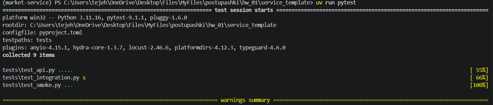
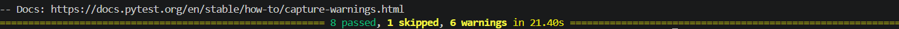
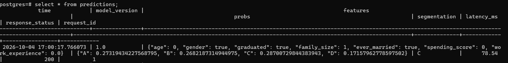
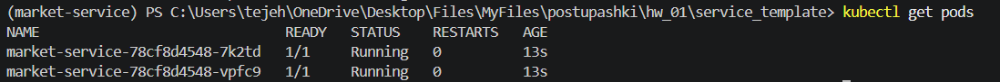
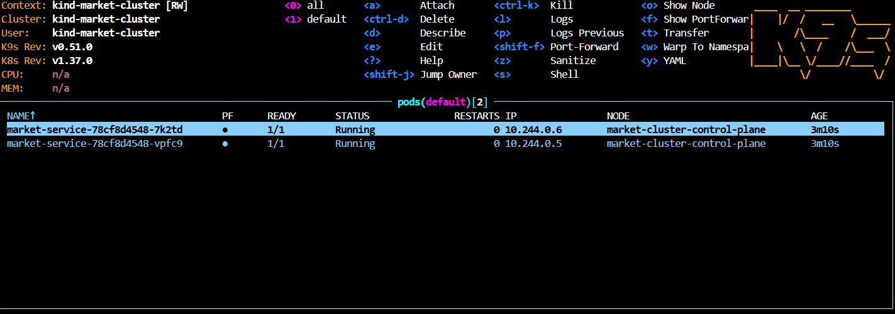
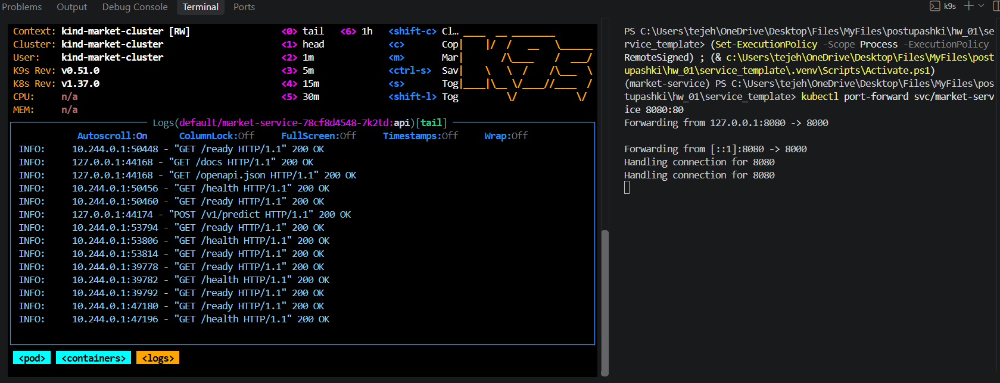

# 2.

### 1. Кэш build job

В первом прогоне job `build` шёл `16s` секунд, во втором — `18s` секунд
(ссылка на первый прогон: https://github.com/Radfull/service_template/actions/runs/38894380401/job/116951410234, 
на второй: https://github.com/Radfull/service_template/actions/runs/38894380401/job/116954163730).
Из кэша взялся слой `RUN uv sync --frozen --no-dev --no-install-project`,
потому что его входные файлы (`uv.lock`, `pyproject.toml`) между коммитами не менялись —
следовательно, Dockerfile на этом шаге даёт тот же результат.

### 2. ImagePullBackOff при зелёном deploy

Поды в `ImagePullBackOff` — это старые реплики предыдущей Deployment,
которые Kubernetes ещё не успел удалить в момент, когда `kubectl rollout status`
отрапортовал успех. Прогон зелёный, потому что критерий
успеха — `N/M ready` у нового ReplicaSet, а не отсутствие ошибок у старых подов.

### 3 Путь пароля базы

Пароль лежит в GitHub Secrets.
В ci  читается как `${{ secrets.DB_PASSWORD }}` и через шаг `kubectl create secret`
сохраняется в Kubernetes Secret. В Deployment контейнер получает его
через `secretKeyRef` как переменную окружения (или через `envFrom`), а приложение
читает её через `pydantic-settings` из `DATABASE_URL`. В `configmap.yaml` пароль
класть нельзя, потому что ConfigMap не шифруется, виден всем, у кого есть RBAC
на `get configmaps`, пишется в `kubectl describe pod` и в логи - Secret как минимум
ограничен отдельными правами и не попадает в диагностический вывод.

### 4. Если убрать `needs: tests` у `build`

`build` начнёт запускаться параллельно с `tests`, и образ будет собираться, даже
если тесты падают. Разработчик пушит коммит с ошибкой в коде,
`tests` краснеет, но `build` уже успел запушить в GHCR образ с тегом по sha —
и `deploy` (если он тоже без `needs` или с `needs: build`) выкатит этот образ
в кластер. Получаем в проде сломанную версию, при этом сам пайплайн будет выглядеть
частично зелёным. `needs: tests` — единственная гарантия, что артефакт в registry
прошёл проверки.

### 5. Почему на pr только тесты

На pull request выполняются только `tests`, а `build` и `deploy` пропускаются,
потому что в их `if:` стоит `github.ref == 'refs/heads/main'` — на pr `github.ref`
равен `refs/pull/N/merge`, условие ложно, job skipped. Сделано это, чтобы не
засорять registry образами из непроверенных pr и не выкатывать в кластер
код из ветки, которую ещё не смержили. Плюс секреты (`DB_PASSWORD`, push в GHCR)
на pr из форков недоступны, и запуск `deploy` всё равно бы упал.

### 6. `pg_advisory_xact_lock` в `init()`

Блокировка нужна, чтобы несколько реплик сервиса не пытались одновременно вызвать
`create_all` при пустой базе: без неё обе реплики параллельно создают таблицу
`predictions`, одна успевает, вторая падает с `DuplicateTable`. `pg_advisory_xact_lock`
берётся на время транзакции и снимается автоматически при commit/rollback, поэтому
вторая реплика просто подождёт, увидит готовую схему и продолжит работу.

### 7. Три статуса подов по порядку жизни

**`Pending`** — scheduler не нашёл узел с подходящими ресурсами. В моём
прогоне с `requests.memory: 1000000000Mi` под до этого статуса не дошёл:
admission отклонил манифест (`must be less than or equal to memory limit
of 512Mi`), потому что requests оказался больше limits.
https://github.com/Radfull/service_template/actions/runs/38954426082/job/117154015494

**`CreateContainerConfigError`** — узел найден, образ скачан, но kubelet
не может собрать env контейнера. Упал `kubectl set image deploy/market-service`:
https://github.com/Radfull/service_template/actions/runs/38956479017/job/117160972164

**`CrashLoopBackOff`** — образ скачан, контейнер стартует и сразу падает.
В моём прогоне с поломкой config под `market-service-585bf6b66-m8nb5`
ушёл в `CrashLoopBackOff` (`RESTARTS 4`), в логах —
`FileNotFoundError: 'artifacts/model_bad.joblib'` в `joblib.load`.
Kubelet перезапускает контейнер с экспоненциальной задержкой — это и есть
`CrashLoopBackOff`.
https://github.com/Radfull/service_template/actions/runs/38951405888/job/117143871065

Хороший запуск: https://github.com/Radfull/service_template/actions/runs/38957512356/job/117164419960

# 3.

## 2.1.

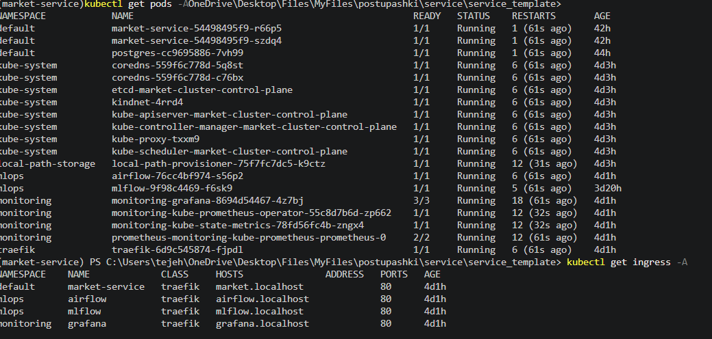
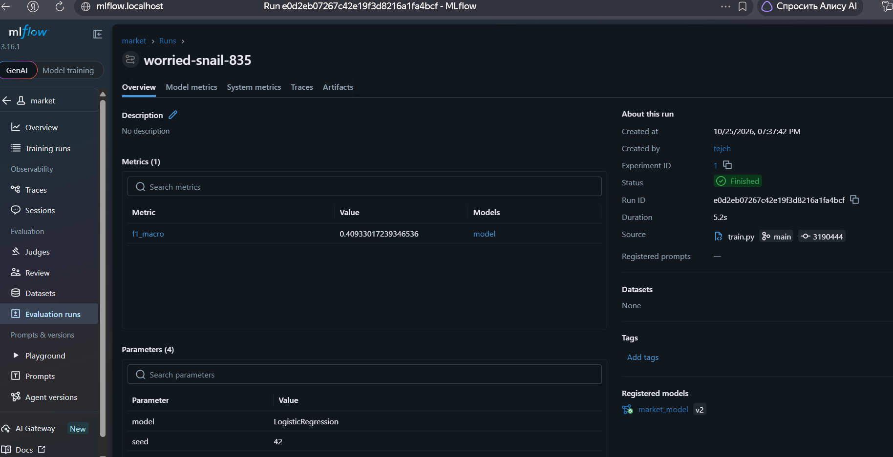

## 2.2.

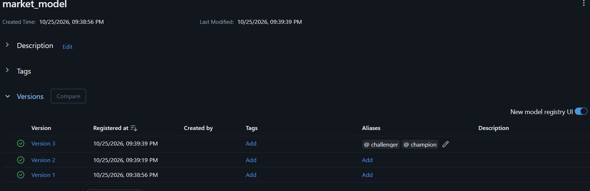
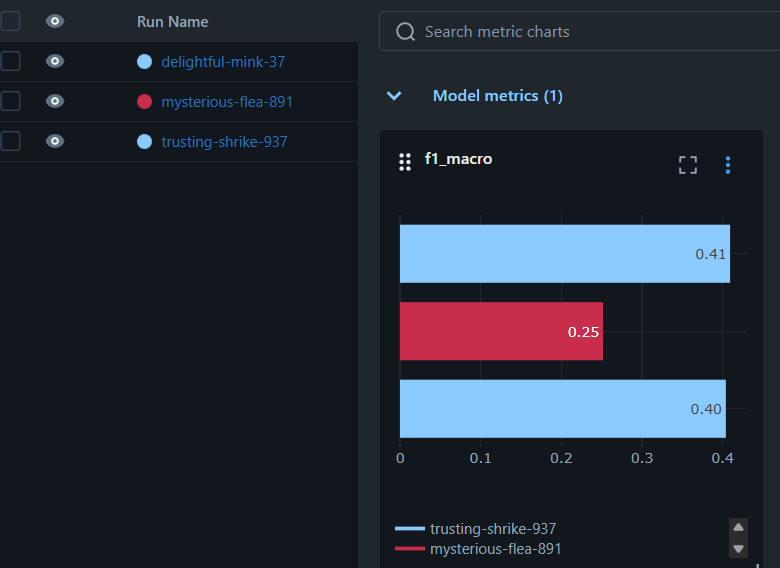

## 2.3.

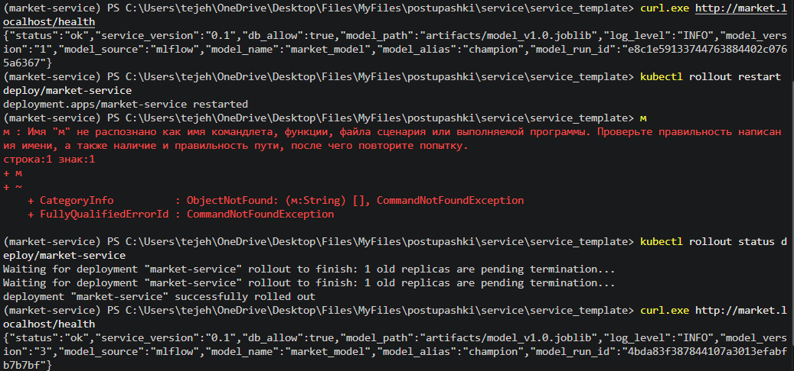

## 2.4.

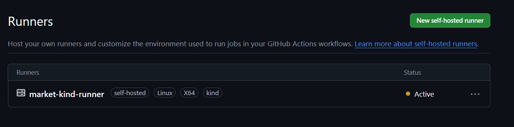
Зеленый прогон:
https://github.com/Radfull/service_template/actions/runs/40900709690/job/123543262150

## 2.5

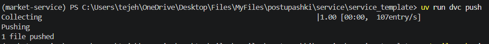
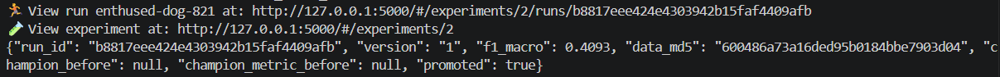
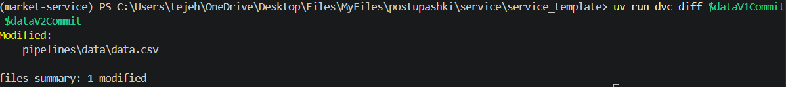
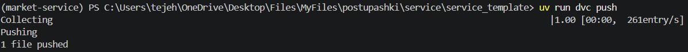
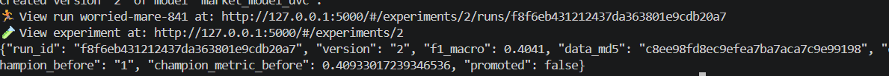

# 2.6
Результаты прогонов представлены в папке results.
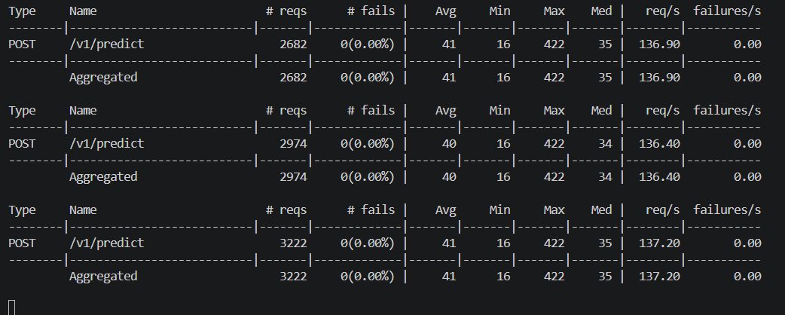
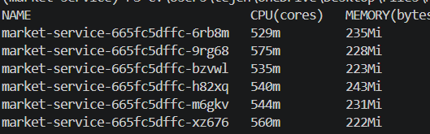
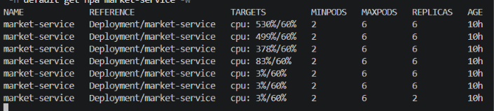

# 2.7

1. прогон с ошибкой:
https://github.com/Radfull/service_template/actions/runs/42024803730/job/127249014787
прогон исправленный: https://github.com/Radfull/service_template/actions/runs/42031109176/job/127257913969

сбой на шаге сервис.

2. прогон с ошибкой: https://github.com/Radfull/service_template/actions/runs/42461646103/job/128672496539

прогон исправленный:
https://github.com/Radfull/service_template/actions/runs/42462551977/job/128674987992

ошибка на шаге: доступ к локальному кластеру. По логам все понятно: ERROR: could not locate any control plane nodes for cluster named 'bad-cluster'. Use the --name option to select a different cluster

3. прогон с ошибкой: https://github.com/Radfull/service_template/actions/runs/42463599540/job/128678131993

прогон исправленный: https://github.com/Radfull/service_template/actions/runs/42464727293/job/128805539502

ошибка на шаге: smoke через Ingress. curl: (22) The requested URL returned error: 404

# 3.

### 1. Почему tests и build в облаке, а deploy локально?

В `.github/workflows/ci.yaml` тесты используют отдельный psql, а сборка отправляет образ в GHCR: доступ к локальному кластеру им не нужен. Для текущего deploy нужен доступ к Docker и внутреннему API kind за NAT, которого у GitHub-hosted runner нет. Альтернативы - туннель до кластера или GitOps с агентом внутри него. локальный runner удобен для этого случа, потому что сам получает задания из GitHub и выполняет существующие команды рядом с кластером.

### 2. Сеть kind, Docker socket и группа 0

`--network kind` даёт runner доступ к узлу `market-cluster-control-plane` по внутренней сети: без неё используемые в CI kubeconfig и адрес Ingress будут недоступны. Сокет `/var/run/docker.sock` нужен для `docker pull`, получения kubeconfig через kind и `kind load docker-image`. без него runner не сможет работать с Docker хоста. `--group-add 0` даёт доступ к сокету, если его группа- GID 0 и разрешена групповая запись. без подходящих прав будет `permission denied`. Сама команда запуска runner в репозитории не сохранена, но в `platform/runner.Dockerfile` пользователь `runner` уже добавлен в группу `root`.

### 3. Зачем dry-run и apply для Secret?

В CI `kubectl create secret ... --dry-run=client -o yaml` только формирует манифест, а `kubectl apply -f -` создаёт или обновляет Secret. Поэтому повторный деплой работает с уже существующим `market-secrets`. Обычный `create secret` во второй раз завершился бы ошибкой `AlreadyExists` и остановил шаг.

### 4. Challenger, champion и откат

В `train.py` каждая новая версия получает `challenger`, а `champion`- только 1 модель или модель с `f1_macro > old_metric + MIN_GAIN` (по умолчанию запас равен 0, для демонстрации работы). Алиас позволяет менять рабочую модель без изменения номера версии в конфигурации: `load_model()` разрешает `champion` в конкретную версию при старте. Для отката модели нужно перевесить алиас и перезапустить поды. `rollout undo` возвращает предыдущий шаблон Deployment, но не возвращает прежнее значение алиаса в MLflow.

### 5. Деплой до первого обучения

В ConfigMap задан `MODEL_NAME: market_model`, поэтому при отсутствии модели или алиаса `champion` загрузка из MLflow выбросит исключение и запуск приложения завершится. Перехода к локальному файлу при такой ошибке нет: он используется только без `MODEL_NAME`. В k9s будут видны неготовые поды и повторные рестарты, затем `CrashLoopBackOff`. CI остановится по тайм-ауту `kubectl rollout status`, а шаг диагностики выведет ошибку MLflow из логов контейнера.

### 6. Путь запроса к MLflow

 Путь такой: `mlflow.localhost:80` → `127.0.0.1:80` → проброс Docker на порт узла kind `30080` → NodePort Traefik → Ingress с host `mlflow.localhost` → Service `mlflow:5000` в `mlops` → под MLflow на порту `5000`. `--allowed-hosts` разрешает нужные значения HTTP Host, а `--cors-allowed-origins` задаёт разрешённые браузерные Origin для CORS ([документация MLflow](https://mlflow.org/docs/latest/self-hosting/security/network/)). Проброс `hostPort: 80` задан в `platform/kind-config.yaml` при создании Docker-контейнера узла. Применение Ingress позже этот проброс не создаёт.

### 7. Расчёт HPA и медленное уменьшение реплик

На [скриншоте HPA](images/image20.png) при шести репликах загрузка равна `536%`, цель — `60%`: по формуле `ceil(6 × 536 / 60) = 54`, но `maxReplicas: 6`. Уменьшение задерживает стандартное окно стабилизации 300 секунд, тогда как для увеличения такого окна по умолчанию нет. 

### 8. Git, DVC и восстановление данных модели N

В Git лежат код, настройки DVC и `pipelines/data/data.csv.dvc` с хешем и размером; содержимое CSV хранится в кэше DVC и после `dvc push` — в локальном remote `../dvc-storage`. Для версии N нужно открыть связанный с ней run в MLflow и взять параметр `data_md5`, который записывает `train.py`. Затем через `git log -p -- pipelines/data/data.csv.dvc` найти коммит с таким MD5, восстановить указатель командой `git checkout <commit> -- pipelines/data/data.csv.dvc` и выполнить `uv run dvc pull`. MD5 восстановленного CSV должен совпасть с `data_md5`; без доступа к remote или сохранившемуся кэшу один файл `.dvc` данные не восстановит.
